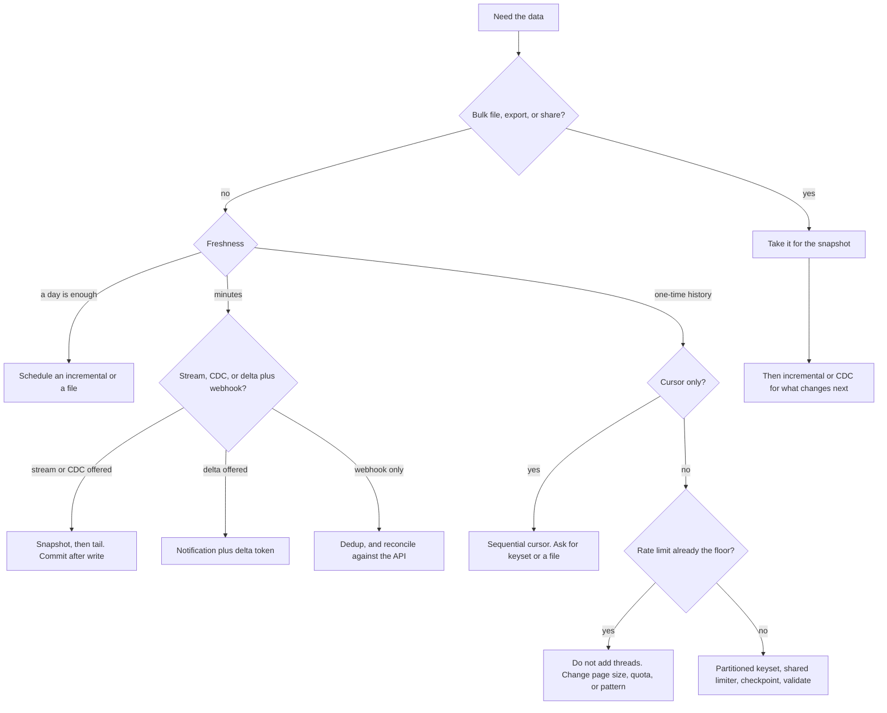

# Decision guide

Start with the five questions. Who moves the data. How much moves. How fresh it must be. Snapshot, changes, or history. What the provider will refuse.

The interactive version is [modules/decision.html](modules/decision.html).

## Scenarios

Numbers marked *model* are arithmetic illustrations, not measurements and not vendor limits. The Defender 100-K split and the Salesforce 2,000-record hint are from their docs. See [SOURCES.md](SOURCES.md).

### SaaS CRM, 50 million records, REST and a bulk export

*Model:* 50,000,000 / 1,000 = 50,000 calls. At 200 ms each, sequential time is about 10,000 seconds before any rate limit. Use the bulk export for the snapshot. Use the incremental or delta API after that. Page only if the export does not exist. What goes wrong: treating the export as a live tail, or letting signed URLs expire.

### Government open data, 1,000 rows per page, a strict limit

*Model:* 1,000,000 rows is 1,000 calls. If the real limit is a handful of calls per 30 seconds, the floor is hours. Threads add 429s. Raise the page size to the documented maximum, request a key if one raises the limit, or take a file. FDIC is the counter-example we measured: maximum 10,000, 27,835 rows, 3 calls, 2.9 seconds. The page size was the whole story.

### Security telemetry, 250,000 devices

A morning vulnerability report can be a snapshot file. Defender's docs say JSON responses fit organizations under 100-K devices and via-files fits more than 100-K. 250,000 is on the file side of that hint. Near-real-time detections are a different feed: the event stream, not the nightly table. What goes wrong: polling the snapshot API every minute and calling it real-time.

### Identity changes within minutes

Graph-style delta plus a change notification. The notification says "look". The delta token says what changed, including deletes when the API sends them. A nightly full pull misses the minute. A webhook alone misses an event. Advance the delta token only after the merge commits.

### E-commerce order webhooks

Verify the signature. Ack fast. Dedup on the event id. Put work on a queue. Run a reconciliation pull of the orders API. What goes wrong: a 200 that arrives after you already wrote the row, or a dropped POST you never notice.

### On-premises SQL Server to a lakehouse, near real time

Log-based CDC or a managed connector, after a snapshot, from the log position taken at the snapshot. Direct `SELECT *` on the primary will hurt the application and will miss deletes. What goes wrong: dropping the CDC reader so the log disk fills, or a schema change that crashes the sink.

### IoT, one reading a second

*Model:* 10,000 devices is 10,000 events per second. A REST call per reading will not keep up and may violate the terms. Use MQTT or a stream, partitioned by device id so one device stays in order. Persist a resume token. Backfill gaps from a batch API if one exists.

### Partner nightly CSV over SFTP

Agree the name, the format, and a done marker. Ignore files without the marker. Validate the header. Load idempotently on the file id. What goes wrong: loading `file.csv` while the writer still has it open.

### A website with no API

Ask for a feed. If the terms, robots.txt, and privacy rules allow reading a public page, a careful scrape is a last resort and it will break. If the terms forbid it, stop. Practice on a site built for it, such as books.toscrape.com. Do not build bypasses.

## After you choose

Write down the pattern, the freshness you promised, and the constraint you measured (page size, latency, rate-limit window, or "none of those, we have a file"). Revisit the note when volume grows by 10x.
