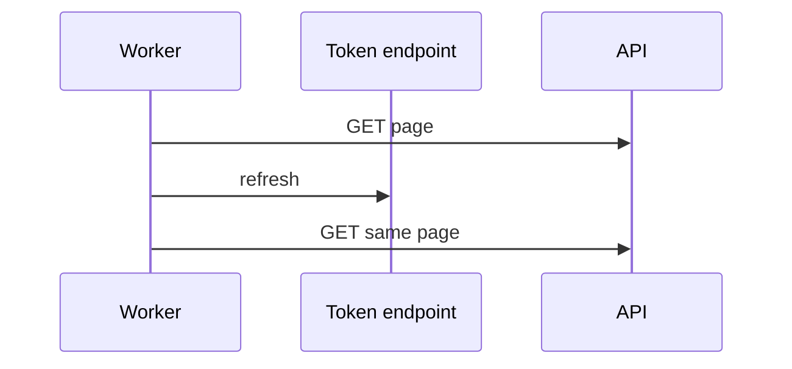
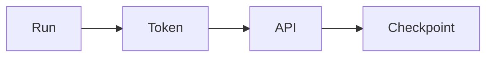

# Auth and token expiry

API keys, OAuth client credentials, authorization code with refresh, managed identities, mTLS, and signed URLs are different ways to prove you may read. A token that dies mid-pull is a resume problem, not a new extract.

Analogy: A visitor badge that expires at noon. You do not start the museum tour over. You get a new badge and continue at the room you were in.

## Patterns

API keys are simple and easy to leak. OAuth client credentials fit a daemon. Authorization code fits a user. Refresh tokens exist so you do not ask the user again. Managed identities avoid a stored secret in clouds that support them. mTLS is a certificate instead of a header. Signed URLs are a capability for one object, for a few minutes.

Store secrets in a secret store. Do not commit them. Do not log them. Scope them to read.

## Mid-run expiry

On 401, refresh once and retry the same page. If refresh fails, stop and keep the checkpoint. The next run continues. Do not restart from page zero because a badge expired.

## Diagram: Refresh, then the same page

1. **Expired.** 401. The page was not applied.
2. **New token.** One refresh. Do not loop if the refresh itself is denied.
3. **Continue.** The checkpoint has not moved. The page is retried, not skipped.

## Diagram: Token dies mid-pull

1. **401.** The badge expired between pages. Rows already landed are fine.
2. **Refresh and resume.** New token, same cursor.

## Examples

- Standard: OAuth 2.0. Pattern: client credentials, authorization code, and refresh tokens are in the OAuth 2.0 framework. Confirm the vendor's token lifetime. Do not hard-code one. Source: https://datatracker.ietf.org/doc/html/rfc6749

## Landing

The checkpoint is independent of the token. Tokens are not data. Do not land them.
