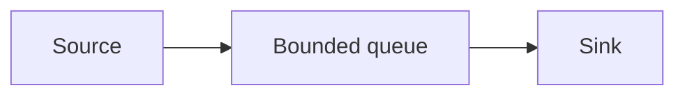

# Memory and backpressure

If the producer is faster than the sink, something has to slow down, buffer, or drop. Dropping is data loss. An unbounded list is a future crash.

Analogy: A funnel. If you keep pouring and the neck is narrow, the counter floods. A good funnel tells the tap to wait.

## What to do

Stream pages and files. Bound every queue. When the queue is full, stop reading. That is backpressure. It shows up as consumer lag or a paused HTTP client, which is healthier than an out-of-memory kill.

Chunk large files. Never fetchall(). A million small Python dicts is a memory tax you do not need.

## Diagram: Bounded queue

1. **Fast source.** Events arrive faster than the sink writes.
2. **Full.** The queue refuses more. The reader pauses. Nothing is dropped.
3. **Drain.** The sink catches up. Reading resumes.

## Landing

Spill a full queue to disk if you must buffer a burst. An in-memory backlog is not a design.
