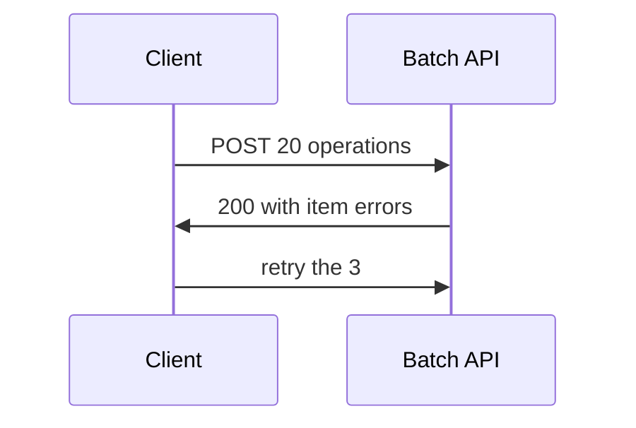

# Batch request APIs

A batch endpoint bundles many operations into one HTTP call. It saves round trips. It does not raise the rate limit, and part of the batch can fail while the rest succeeds.

Analogy: One envelope with twenty letters. The post office can reject three letters and deliver seventeen. You still have to open the envelope.

## Why it exists

Chatty APIs punish latency. A batch collapses twenty GETs into one request. Providers then throttle the inner operations, or count the batch as N calls, so you cannot smuggle a million reads through one HTTP status.

## Partial failure

Inspect each item status. Retry only the failed items. Landing the whole batch because the outer call was HTTP 200 will hide missing records.

Order is not a transaction unless the docs say it is. Do not assume item 8 sees the write from item 3.

## Diagram: One call, many outcomes

1. **Bundle.** Fewer round trips. Same business limits.
2. **Partial.** The envelope succeeded. Three items did not. Read the item codes.
3. **Selective retry.** Retrying the whole batch can duplicate the 17 that worked.

## Examples

- Identity: JSON batching pattern. General pattern: outer HTTP success does not mean every inner call succeeded. Confirm whether the vendor counts inner calls against the quota. This course does not invent that count. Source: https://learn.microsoft.com/en-us/graph/json-batching

## Landing

Write a result row per inner request, including status and error. Silver keeps only the successes. The retry job reads the failures, not the whole batch.
