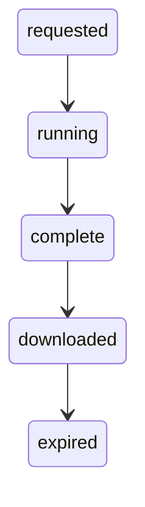
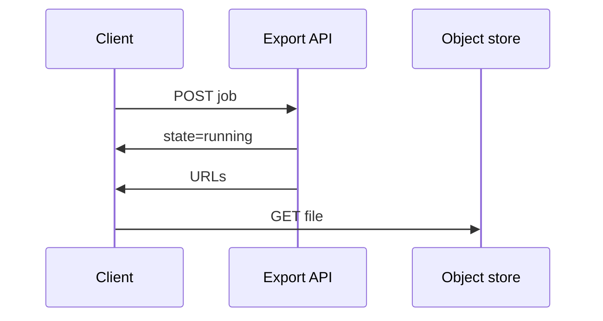
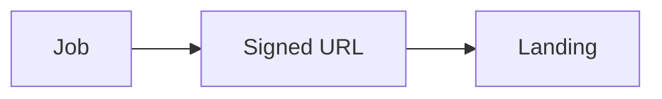

# Async bulk export

Ask for a job, poll or wait for a callback, download compressed files, sometimes from URLs that expire. This is usually the right tool once paging would take an hour.

Analogy: The library mailing you boxes instead of handing you one shelf at a time. The boxes have a pickup deadline.

## Why providers offer it

They can scan once, write files, and hand you object storage. That is cheaper for them than a thousand interactive queries, and kinder to other tenants.

The file is a point-in-time snapshot. It is not a live tail. Freshness is 'as of job start', which you should store.

## Failure modes

Signed URLs expire. A downloader that starts late gets 403 and must ask for fresh URLs, not invent a retry of the old URL forever.

Download files in parallel only up to the documented concurrency. Poll politely. A job that is still running is not a failure.

Partial files and truncated gzip are real. Check size, checksum, or a manifest before you archive the job as done.

## Diagram: Export job

1. **Requested.** You asked. You do not have data yet.
2. **Running.** Poll, or wait for a callback. Do not start the download.
3. **Complete.** URLs are ready. Note the expiry.
4. **Downloaded.** Files checked, then landed. Checkpoint the job id.
5. **Expired.** The URL died. Ask for a new URL. Do not treat 403 as an empty file.

## Diagram: Poll, then download

1. **Start.** Filters and format go in the request. Save the job id.
2. **Poll.** Running is progress. Back off the poll.
3. **Ready.** URLs are capabilities with a clock on them.
4. **Download.** Parallel downloads, checksum, then mark the job landed.

## Diagram: Expired URL, then the fix

1. **URL dies.** The download starts after expiry and gets 403. The snapshot still exists.
2. **Refresh.** Ask the job API for new URLs. Do not keep the dead one.
3. **Land.** Download, verify, checkpoint.

## Examples

- CRM: Salesforce Bulk API 2.0. Checked 2026-10-28: both Bulk APIs are asynchronous. Salesforce says any operation of more than 2,000 records is a good candidate for Bulk API 2.0, and jobs under 2,000 should use synchronous REST or SOAP. There is no SLA because the work is background. Source: https://developer.salesforce.com/docs/platform/api-asynch/guide/asynch-api-intro.html
- Security: Defender Vulnerability Management. Checked 2026-10-28: JSON response is described as best for small organizations with less than 100-K devices. Via files is recommended for large organizations with more than 100-K devices. The payload is a current snapshot, not history. A separate delta export is a date range, not a full export. Source: https://learn.microsoft.com/en-us/defender-endpoint/api/get-assessment-software-vulnerabilities

## Landing

Land the files untouched in bronze, with job id, snapshot time, and URL expiry. Silver parses after checksum. Do not delete the source file until silver succeeds.
