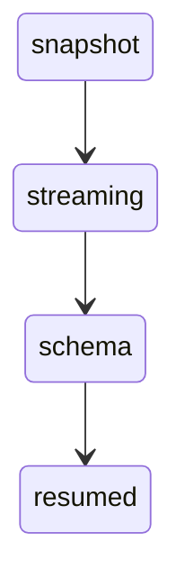
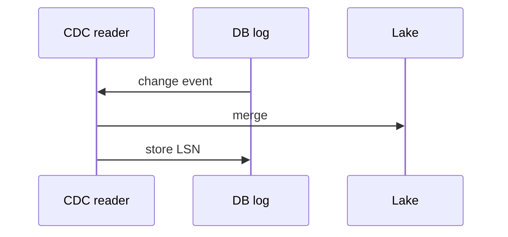

# Change data capture

Log-based CDC reads the database's own change log. You get inserts, updates, and deletes in commit order, after an initial snapshot. You are not polling the table.

Analogy: Reading the library's checkout log instead of recounting the shelves every hour.

## Why the log

The database already writes a durable history of changes so it can recover. CDC readers tail that history. They see deletes. A query on updated_at often does not.

The outbox pattern is the application writing events into a table in the same transaction as the business change, then a publisher reading that table. Use it when you own the application and the log format is not a contract you want to leak.

## Snapshot, then stream

The first run copies the current table. Then the reader switches to the log position taken at the snapshot. Miss that handoff and you gap or overlap. Overlap is fine if the sink is idempotent. A gap is not.

Schema changes are events. A new column should not crash the pipeline. Quarantine unknown shapes, do not drop the slot, or the database may be forced to keep logs until the disk fills.

## Diagram: CDC

1. **Snapshot.** Copy the table. Record the log position.
2. **Streaming.** Apply log events after that position, in order, per transaction.
3. **Schema change.** A new column arrives. Evolve the landing schema or quarantine. Do not abandon the slot.
4. **Resumed.** Restart from the stored log position, not from a new snapshot, unless the position expired.

## Diagram: Read the log, commit the position

1. **Read.** The log is the source of truth for what changed.
2. **Apply.** Upsert or delete in the lake, idempotent on primary key plus LSN.
3. **Checkpoint.** Advance the position after the apply. Same rule as a stream offset.

## Examples

- Databases: Debezium and engine CDC. Pattern: Debezium, SQL Server CDC, and Postgres logical replication are log readers plus a snapshot. Confirm slot retention and snapshot locking on the current connector page. No latency SLA is claimed. Source: https://debezium.io/documentation/reference/stable/connectors/postgresql.html

## Landing

Bronze can store the change events with LSN. Silver is the current row plus a history table if you need it. Gold does not read the log directly.
