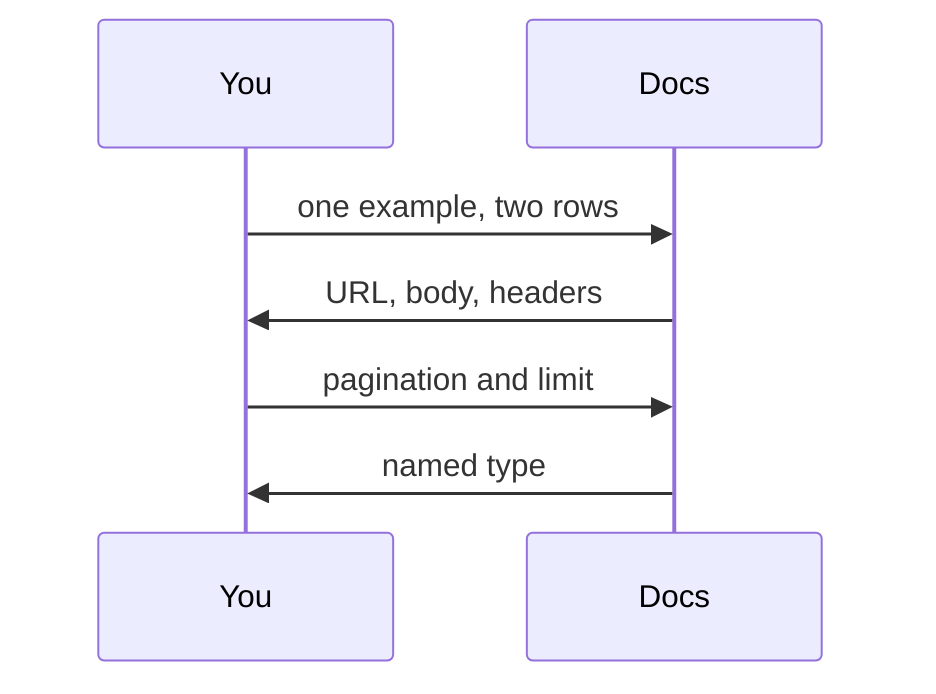
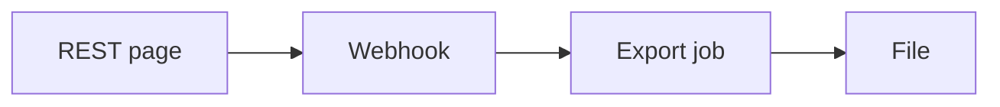
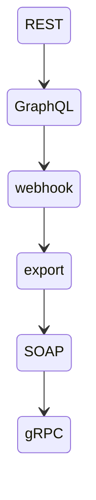

# The API types you will actually meet

Six shapes cover almost every pull. REST JSON is the default. GraphQL, webhooks, and bulk export are the other three you should recognize on sight. SOAP and gRPC are common too, but in older enterprises and inside companies, not on most public data APIs.

Analogy: Six doors. You do not need the floor plan of the building until you know which door you are standing in front of.

## This is a teaching judgment, not a census

Nobody publishes a reliable 'percent of all APIs' number that is worth quoting. What follows is the set a data engineer hits in the first year: public data, SaaS, and the internal platform. If the docs do not match one of these, use the full map. Do not force a source into a type because it is familiar.

## 1. REST JSON. The default

A URL, an HTTP verb, and a JSON body. This is GitHub, Stripe, FDIC BankFind, and most SaaS products. You ask. They return a page. You come back.

The variation that matters is pagination, not the word REST. Offset or page number, a cursor, a Link header, or an OData @odata.nextLink. Microsoft Graph is REST with nextLink. Stripe's list API is REST with a cursor hiding in starting_after. FDIC is REST with limit and offset, maximum 10,000.

The usual pain is a page cap plus a rate limit. Read the maximum page size and the rate-limit window before you add threads. The deeper lesson is the REST pagination and rate-limit modules.

## 2. GraphQL. You name the fields

One POST, usually to /graphql, with a query document. You ask for the fields you want, including nested objects, and you page with a connection cursor: edges, node, pageInfo, endCursor.

You meet it on GitHub's GraphQL API, Shopify, and a lot of product APIs built after about 2018. It is less common than REST for bulk extracts, and more common when a product team got tired of clients over-fetching.

The provider's defense is query cost, not a page-size sentence. A wide query can be rejected even if the page is small. You still cannot parallelize an opaque cursor.

## 3. Webhooks. They call you

You give them a URL. When something happens, they POST a JSON body to it, usually with a signature. Stripe, GitHub, Slack, and shop platforms do this for orders, pushes, and messages.

This is not an extract. It is a doorbell. Events drop, duplicate, and arrive late. A webhook feed without a reconciliation pull against the REST API will lose rows. Verify the signature, dedup on the event id, ack fast.

## 4. Bulk export. A job, then a file

You POST a job, poll until it is complete, then download a compressed file. Sometimes the download URL expires. Salesforce Bulk API 2.0 is the textbook: more than 2,000 records is their own hint to stop using synchronous calls. Defender Vulnerability Management says the same thing in different words: JSON pages for smaller estates, files past about 100,000 devices.

If the docs mention jobs, exports, or download URLs, take that path for the snapshot. Page only if they do not offer it.

## 5. SOAP. Still in the building

XML envelope, a WSDL contract, and paging fields inside the body. You will meet it in banks, governments, and older ERP systems. New public APIs are rarely SOAP. Old systems that hold the money often are.

HTTP 200 can still carry a SOAP fault. Do not land a fault as a row. If they also drop a nightly file, take the file.

## 6. gRPC. Inside the company

A protobuf contract and HTTP/2. Unary calls look like a function. Server streaming looks like a list that never becomes a web page. Common between internal services. Uncommon as the public API a partner gives you for a nightly extract.

A stream is not storage. Checkpoint the last id, and set a deadline. If the public door is REST and the internal door is gRPC, pull from whichever one your team is allowed to call.

## How to name it in ten minutes

Open the docs and find one example that returns two records. Look at the URL and the body. POST /graphql means GraphQL. A WSDL or an XML envelope means SOAP. A .proto file means gRPC. A job id and a download URL means bulk export. A 'we will POST to your server' section means webhooks. Everything else that returns JSON from a URL you call is REST. Then find the pagination parameters and the rate-limit sentence before you write a loop.

## Diagram: Name the door from one example call

1. **Read one call.** Ignore the marketing page. You want a real request and a real response.
2. **Look at the shape.** JSON from a URL you call is REST. A query document is GraphQL. XML plus WSDL is SOAP.
3. **Find the constraint.** Page size, cursor or offset, rate-limit window, and whether a file export exists.
4. **Stop guessing.** Then open that module. Do not start with threads.

## Diagram: The four you will use on a pull

1. **REST is the daily door.** Most extracts start here. Page, land, checkpoint.
2. **Webhook is a hint.** It tells you something changed. It is not the ledger.
3. **Export when paging is the hour.** A job writes the file. You download it once.
4. **Land the file.** Checksum, then bronze. The page loop was the fallback.

## Diagram: Which common type is this?

1. **REST.** You call a URL. JSON comes back. Look for limit, offset, cursor, Link, or nextLink.
2. **GraphQL.** You POST a query. Page with endCursor. Watch the cost limit.
3. **Webhook.** They POST to you. Signature, dedup, then reconcile.
4. **Export.** Job, poll, download. URLs expire.
5. **SOAP.** XML envelope. A fault can hide in HTTP 200.
6. **gRPC.** Protobuf and a stream or a unary call. Checkpoint the last id.

## Examples

- REST: FDIC, GitHub, Stripe. Checked 2026-10-28: FDIC is limit/offset, max 10,000. GitHub pages with a Link header and limits 60/hour unauthenticated, 5,000/hour with a token. Stripe lists use limit 1-100 and starting_after. Source: https://docs.github.com/en/rest/using-the-rest-api/using-pagination-in-the-rest-api
- GraphQL: GitHub GraphQL. GitHub documents a separate query-cost limit from the REST budget. Confirm the current points on that page before you estimate a pull. Source: https://docs.github.com/en/graphql/overview/rate-limits-and-query-limits-for-the-graphql-api
- Bulk: Salesforce and Defender. Checked 2026-10-28: Salesforce says more than 2,000 records is a Bulk API 2.0 candidate. Defender says JSON pages under 100-K devices and files above that. Source: https://developer.salesforce.com/docs/platform/api-asynch/guide/asynch-api-intro.html

## Landing

Whatever the type, bronze is the raw response or file plus the cursor, job id, or event id. Silver dedups on the primary key. The type tells you how the bytes arrive. It does not change that rule.
