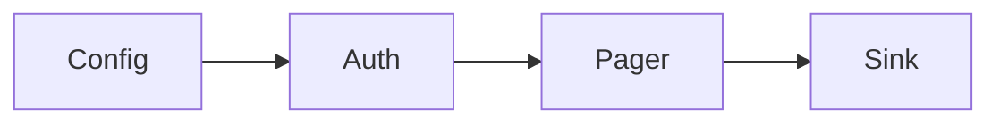

# Build a connector

A connector is config, auth, a pagination strategy, incremental state, a rate limiter, retries, a schema check, a writer, and metrics. Frameworks differ in how much of that they already built.

Analogy: A truck with a standard loading dock. Singer, Airbyte, dlt, and Kafka Connect are different docks. The cargo rules are the same.

## Anatomy

Strategy pattern for pagination: offset, cursor, keyset, link, bulk job. Pluggable auth. A state store for the cursor. An idempotent sink. Metrics for pages, 429s, and records.

Singer is a spec of taps and targets over JSON lines. Airbyte's connector kit is a framework with a catalog and state. dlt is a Python library that infers schema and loads. Kafka Connect is for moving between a Kafka log and another system. Use Singer or Airbyte when you want a catalog of connectors. Use dlt when you want a Python pipeline. Use Kafka Connect when the log is already the center.

## Testing and agents

Mock the server. Record responses. Inject 429s, 500s, timeouts, and partial files. A connector that only passes the happy path will lose a weekend.

Exposing extracted data as a tool for an AI agent, for example an MCP server, adds a new caller that can loop. Put the same rate limit, the same read-only scope, and a row cap in front of it. An agent is not a reason to turn off pagination.

## Diagram: Connector parts

1. **Configure.** Base URL, page size, auth, and the state path. No secrets in the repo.
2. **Page.** The strategy yields records. The limiter and retry wrap every call.
3. **Write.** The sink is idempotent. State advances after the write.

## Examples

- Frameworks: Singer, Airbyte, dlt, Kafka Connect. Categories, not a ranked benchmark. Read the current docs before you adopt one. This repo includes a small Python template under labs/connector_template. Source: https://dlthub.com/docs/intro

## Landing

The template writes NDJSON and a state file. Swap the sink for Parquet or a warehouse when the shape is proven.
