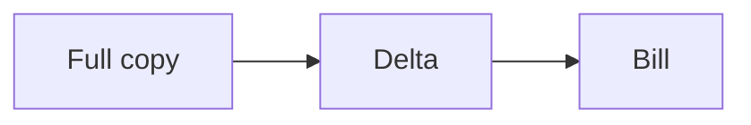

# Cost

APIs charge per call or per row. Egress charges per byte. Streams charge for throughput and retention. Storage and compute charge for landing and transforming. The cheapest design is often the one that moves less, less often.

Analogy: Postage. A thousand small letters cost more than one box, and the box still has a weight fee.

## Levers

Fewer calls: larger pages, bulk export, incremental filters. Fewer bytes: field selection and compression. Less often: a share instead of a copy, or a daily file instead of a per-second stream you do not read.

Prices change and are vendor-specific. This course does not quote a price. Read the current price page and multiply by your measured volume.

## Diagram: Move less

1. **Expensive.** A full copy every hour pays for bytes nobody reads.
2. **Cheaper.** A snapshot once, then changes. Confirm the vendor's meter.

## Landing

Cost is a design input. Record the meter you are optimizing, so a later 'optimization' does not increase a different bill.
