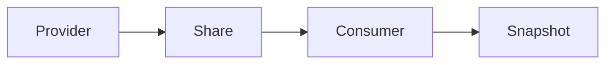

# Sharing without copying

Sometimes the right extract is no extract. Delta Sharing and warehouse-native shares let a consumer query the provider's tables under a grant. You still need to know freshness, schema, and what happens when the share is revoked.

Analogy: A library card instead of a photocopy. You can read the shelf. You do not own the building, and the card can be taken back.

## When not to copy

Copying a 10 TB table every night is egress, time, and a stale twin. A share lets the consumer read in place, or replicate on its own schedule. Open-data portals are the public version: a dataset you query, sometimes with an API in front.

You trade control. The provider can change schema, delay a refresh, or revoke access. Your gold models need a contract and a test, not a hope.

## Still land something

If downstream jobs need a stable snapshot, materialize one on your side and record the share version or timestamp. A dashboard that queries a live share will change under a meeting.

## Diagram: Share, then optional copy

1. **Grant.** Access is a policy, not a file in your bucket yet.
2. **Query.** The consumer reads through the share.
3. **Materialize.** If you need a frozen input, copy a versioned snapshot.

## Examples

- Lakehouse: Delta Sharing. Pattern: an open protocol for sharing lakehouse tables without a custom pipeline per consumer. Confirm the current protocol and recipient model on the project site. No throughput number is claimed here. Source: https://delta.io/sharing/
- Government: Open data portals. Pattern: a portal plus an API. FDIC BankFind, measured in the pagination module, is one public example of API access rather than a private share. Source: https://api.fdic.gov/banks/docs/

## Landing

If you copy, land a versioned snapshot. If you do not copy, record the share version your gold model was certified against.
