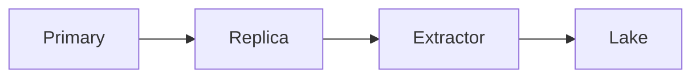

# Direct database extraction

JDBC or ODBC can read a table or a query. It is fast and dangerous. You share the source database with the application that keeps the business running.

Analogy: Counting books by walking into the stacks while people are still shelving. You can block them, or they can move a book between your two hands.

## Why teams do it

There is no API, or the API is a toy in front of a real table. A SQL query is the shortest path. It is also the path that can lock rows, fill temp space, and show up in the on-call channel.

## How to be a polite reader

Use a read replica when you can. Incremental queries on an indexed updated_at or an increasing key beat SELECT *. Parallel range reads split the key space, the same idea as partitioned keyset, and they still hit one database.

Snapshot isolation or a consistent read matters if you need a point in time. A query that runs for an hour on a live table is not one moment.

Never extract through the primary at peak if a replica exists. Agree a query budget with the source team.

## Diagram: Replica, range, land

1. **Do not hit primary.** The application owns the primary. Read the replica.
2. **Ranges.** Split on an indexed key. Each worker seeks, it does not offset.
3. **Land.** Stream rows. A fetch size is a page. Do not fetchall() a billion rows.

## Examples

- Enterprise: JDBC and ODBC. Pattern: full and incremental queries, read replicas, range reads. Locking and source impact are the reason managed CDC exists. No row-rate number is claimed. Source: https://docs.oracle.com/javase/tutorial/jdbc/basics/index.html

## Landing

Bronze is the query text, the replica timestamp, and the files. Silver merges on the primary key. A full refresh is allowed when the table is small and deletes must be exact.
