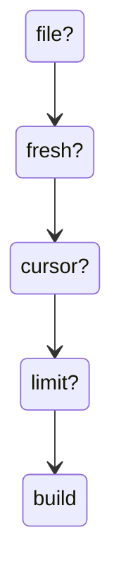

# Decision guide

Pick the pattern from volume, freshness, what the source actually offers, and the constraint that will not move. The tree is a starting point. The scenarios below use illustrative numbers, labeled as such.

Analogy: Choosing a vehicle. Distance, deadline, and whether the road is even open.

## Worked scenarios

CRM, 50 million records, both REST and a bulk export. Illustrative: 50 million / 1,000 pages is 50,000 calls. At 200 ms that is hours, before limits. Use the bulk export for the snapshot. Use incremental or CDC-like deltas after that. Paging is the fallback.

Government open data, 1,000 rows per page, strict limit. Illustrative: 1 million rows is 1,000 calls. If the limit is a handful per 30 seconds, the floor is hours. Raise the page size if allowed, get a key, or take a file. Do not add threads.

Security telemetry, 250,000 devices. A daily snapshot file or the vendor's via-files export fits a morning report. Near-real-time detections need the event stream, not a nightly vulnerability table. Defender's own docs split JSON and via-files around 100-K devices. That is a verified vendor hint, not a universal law.

Identity changes within minutes. Delta query plus a change notification. A nightly full pull will miss the minute. A webhook alone will miss an event.

E-commerce order webhooks. Dedup, signature, queue, and a reconciliation pull of the orders API. The webhook is the hint.

On-premises SQL Server to a lakehouse, near real time. Log-based CDC or a managed connector, after a snapshot. Direct full queries will hurt the primary and miss deletes.

IoT, one reading a second. MQTT or a stream, partitioned by device. A REST pull per reading will fall behind and may be against the terms.

Partner nightly CSV on SFTP. A done marker, schema check, idempotent load. Do not build a fake API in front of a file you already have, unless more than one team needs a contract.

A website with no API. Ask for a feed. If the page is public and the terms allow reading, a careful scrape of a practice-style page is a last resort. If the terms forbid it, stop.

## Diagram: Which pattern

1. **File or export?.** If yes, take it for the snapshot.
2. **How fresh?.** Minutes means stream, CDC, or delta. A day means a schedule.
3. **Cursor only?.** Then you cannot parallelize. Ask for keyset or a file.
4. **Rate limit the ceiling?.** Threads will not help. Change the quota or the pattern.
5. **Then build.** Checkpoint, idempotent sink, reconciliation.

## Landing

Write the choice down: pattern, freshness target, and the constraint you measured. Revisit it when the volume grows by 10x.
