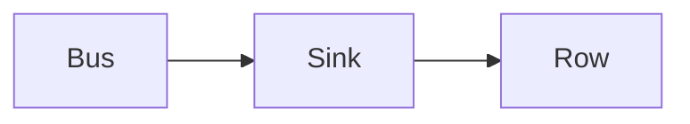

# Delivery guarantees

At-most-once drops data on a crash. At-least-once retries and can duplicate. Exactly-once, in practice, is at-least-once plus an idempotent write.

Analogy: A courier who throws the parcel away if they are unsure, versus one who might deliver twice, versus a shelf that ignores the second identical parcel.

## The three words

At-most-once: send or commit before you know the write landed. A crash loses the record and nobody retries.

At-least-once: retry until the receiver acks. A crash after the write and before the ack duplicates.

Exactly-once is usually a marketing sentence for 'the sink dedups'. End-to-end exactly-once across a database, a bus, and a lake is rare. Design for at-least-once and make the write idempotent.

## Diagram: Same event, twice, one row

1. **First write.** The event lands. The ack is lost.
2. **Replay.** The same key arrives again.
3. **Dedup.** Primary key plus version. The second write is a no-op or a newer version, not a second fact.

## Landing

The sink key is the delivery guarantee. Without it, retries are data corruption.
