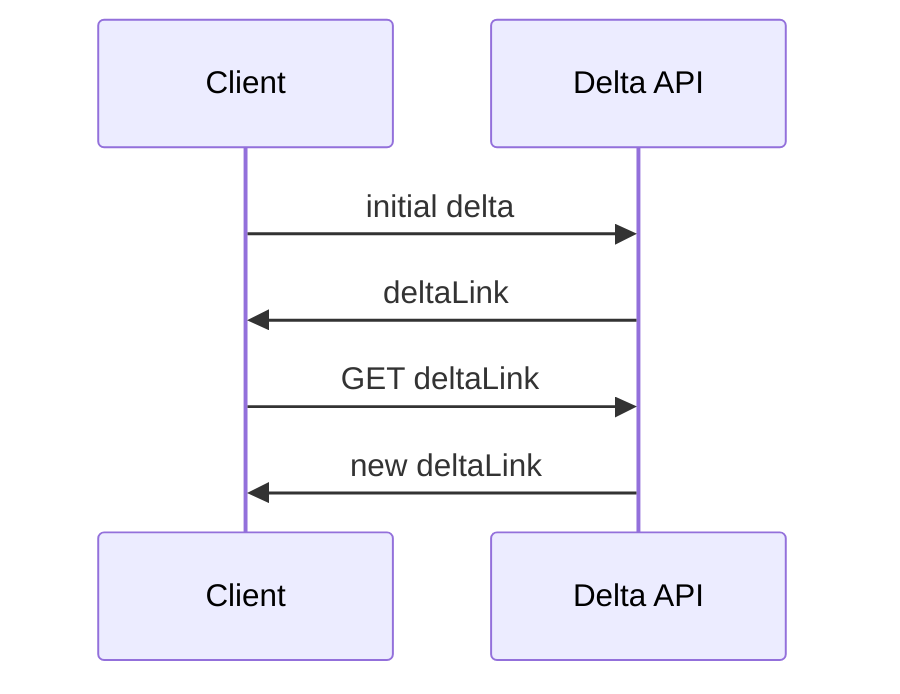
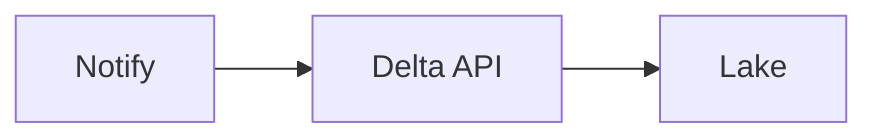

# Delta and incremental APIs

After the first snapshot, ask for what changed. Watermarks, delta tokens, and change feeds exist so tomorrow's pull is not another full scan. Deletes arrive as tombstones, or they do not arrive at all.

Analogy: Asking the librarian what was checked out since yesterday, instead of recounting every book.

## The combination pattern

A webhook or a schedule says 'something changed'. The delta API says what. Notification alone misses events. Delta alone can be delayed if you only poll nightly. Together they are the usual near-real-time design when a stream is not offered.

Store the server's delta token or the server time at the start of a successful run. Using the max updated_at you happened to see can skip a row committed during the run.

## Deletes and overlap

If the API has tombstones, apply them. If it does not, you cannot discover deletes from an updated_since filter. You need a periodic full reconcile.

Overlap the window by a few minutes and dedup. Late events are cheaper than gaps.

## Diagram: Token, then changes

1. **Snapshot.** The first call is the slow one. Save nextLink until it becomes a deltaLink.
2. **Checkpoint.** The token is the watermark. Lose it and you full-scan again.
3. **Changes.** Adds, updates, and tombstones. Apply them in order if the API orders them.
4. **Advance.** Advance the token only after the page is durable.

## Diagram: Notification plus pull

1. **Hint.** The webhook says the collection changed. It may not include the row.
2. **Pull.** The delta call returns the actual changes since the token.

## Examples

- Identity: Microsoft Graph delta. Checked via the official overview URL on 2026-10-28: a delta query pages with @odata.nextLink and, when the round is done, returns @odata.deltaLink. Later calls to that link return changes, not the full collection. Read the page for resource-specific limits before you code one. Source: https://learn.microsoft.com/en-us/graph/delta-query-overview

## Landing

Bronze stores each delta page and the token that produced it. Silver merges on the primary key, applies tombstones, and records the token only after the merge commits.
