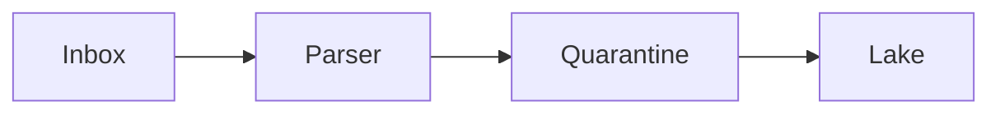

# Email, reports, and spreadsheets

A scheduled CSV in an inbox or a spreadsheet on a share is an API with no contract. It works until someone renames a column or the mail rule moves the file.

Analogy: A colleague sliding a printout under your door. Helpful, and not a system.

## Why it happens

The source system can email a report and cannot expose a table. Teams accept it to move. The extract then depends on a mailbox, a subject line, and a human who owns the report definition.

## How it breaks

Columns move. Dates change format. A totals row is parsed as data. The attachment is missing on a holiday. There is no tombstone and no event id.

Replace it. Ask for a file drop with a schema, or an API. Until then, validate the header row and quarantine surprises. Do not silently shift columns.

## Diagram: A report is not a feed

1. **Header changed.** The parser maps column 3 to amount and writes nonsense.
2. **Check the header.** Expected names, or quarantine. Never guess a shifted column.
3. **Land only matches.** A known header can load. Record the message id so a redelivery does not double.

## Examples

- Operations: Scheduled report exports. Pattern: no stable schema, no deletes, no replay contract. Treat as temporary. No vendor mailbox limit is claimed. Source: https://datatracker.ietf.org/doc/html/rfc5322

## Landing

Store the raw attachment and the message id. Silver loads only if the header matches the contract hash.
