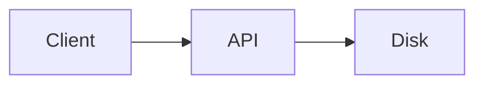
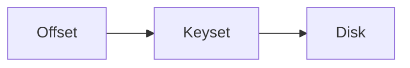
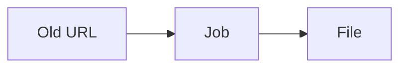
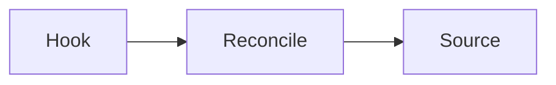
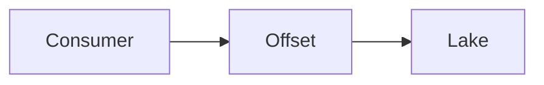
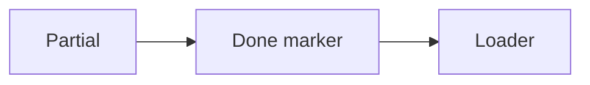
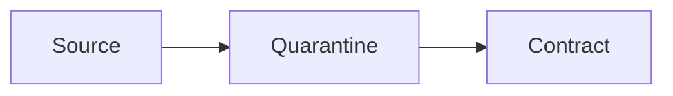
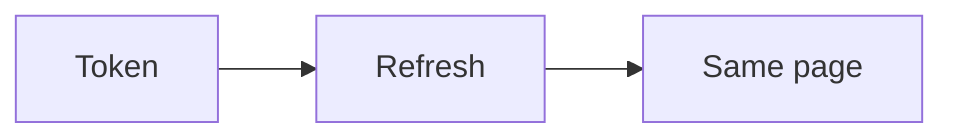

# Failure replay

Eight failures, then the fix. Step through each diagram. The first steps are the break. The later steps are the repair.

Analogy: A flight recorder. You watch the crash, then you watch the checklist that would have prevented it.

## How to use this page

Each diagram is a replay. Steps marked failure show the loss or the duplicate. Steps marked fix show the checkpoint, the key, the refresh, or the reconciliation that closes it.

## Diagram: Crash mid-pull

1. **Died holding a list.** Pages lived in memory. The process died. You have nothing.
2. **Page on disk.** Each page was a file. The checkpoint has the cursor.
3. **Resume.** The next process continues. Finished files are not fetched again.

## Diagram: Offset drift

1. **Skip N.** An insert above the window repeats a row and hides another.
2. **Seek.** id greater than last id does not care about the shifting window.

## Diagram: Expired signed URL

1. **403.** The URL expired. The snapshot is not empty. The URL is.
2. **New URL.** Ask the job for fresh URLs and download those.

## Diagram: Missed webhook

1. **No ring.** The event never arrived. Your table is short.
2. **Pull.** Reconciliation reads the source and fills the id.

## Diagram: Commit too early

1. **Offset moved, write did not.** A crash now skips events that never landed.
2. **Write, then commit.** A crash replays. The sink dedups.

## Diagram: Half-written file

1. **Loaded early.** The loader read a file the writer had not closed.
2. **Wait for done.** No marker, no load.

## Diagram: Schema break

1. **Silent shift.** Column 3 changed meaning. Gold is wrong and green.
2. **Quarantine.** The contract fails the batch. Raw is kept. Silver does not move.

## Diagram: Token expiry

1. **401.** The run stopped. Restarting from zero wastes the landed pages and can duplicate them.
2. **Refresh and resume.** New token, same checkpoint.

## Landing

Every fix lands the same way: durable page, then checkpoint, idempotent key, quarantine for poison.
