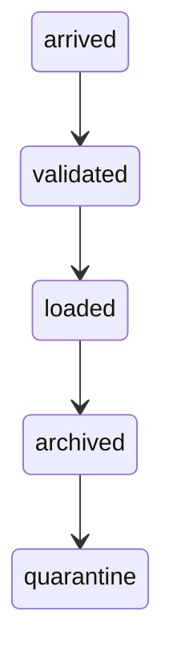

# File drops

A partner drops CSV, JSON lines, Parquet, or Avro on SFTP, S3, or a file share. The hard part is knowing the file is finished, and not loading a half-written one.

Analogy: A courier leaving a box. If you open it while they are still packing, you inventory half the books and call it the shipment.

## Why files

Some partners have no API. A nightly file is the contract. It is simple, replayable, and awful at freshness. Agree the schedule, the name, the format, and the done signal in writing.

## Done markers

Writers should write to a temporary name and rename, or write a manifest and a .done file after the bytes are flushed. Readers ignore files without the marker. A size that is still changing is not done.

Quarantine files that fail schema or checksum. Do not poison the silver table. Archive only after a successful load, so a rerun can find the raw file.

## Diagram: File-drop states

1. **Arrived.** Bytes exist. That is not the same as finished.
2. **Validated.** Done marker, size, and schema checked.
3. **Loaded.** Idempotent load on the file id or a business key.
4. **Archived.** Raw file kept. The load record says which file produced which rows.
5. **Quarantine.** Bad file parked with the error. The pipeline continues.

## Diagram: Half-written file

1. **Too early.** The loader sees data.csv while the writer still has it open. The row count is a lie.
2. **Marker.** The writer closes the file, then writes data.csv.done.
3. **Load.** The loader only picks files with a marker, then lands them.

## Examples

- Partner exchange: SFTP and object drops. Pattern: temporary name plus rename, or a manifest, is the usual done signal. Formats you will see are CSV, JSON lines, Parquet, and Avro. No vendor file-size limit is claimed. Source: https://www.rfc-editor.org/rfc/rfc4180

## Landing

Bronze is the file plus arrival metadata. Silver is parsed rows with the source file name. A rerun of the same file id must not double the facts.
