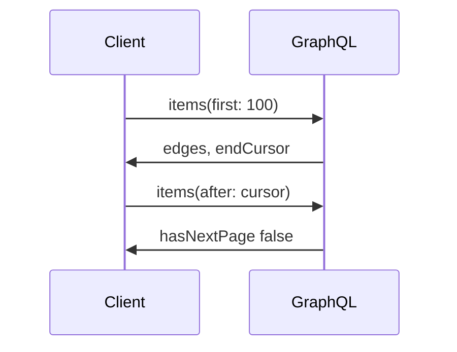
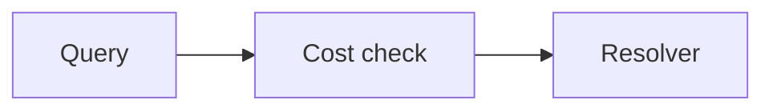

# GraphQL

GraphQL lets the client name the fields and walk connections with cursors. The provider's defense is query cost, depth, and sometimes persisted queries. Subscriptions are a push channel on top of the same schema.

Analogy: Instead of taking a pre-packed shelf, you hand the librarian a shopping list. They still refuse a list that would empty the building.

## Why it exists

REST often over-fetches or forces a second call for a nested object. GraphQL returns the shape you asked for. That is good for mobile clients and dangerous for extract jobs, because one query can fan out across the database.

Connections are the pagination pattern: edges, node, cursor, pageInfo.hasNextPage, endCursor. You still cannot parallelize an opaque cursor.

## Limits and landing

Complexity limits, depth limits, and point budgets exist so a nested query cannot become a denial of service. Persisted queries let the server allow only known documents. Partial errors can return data and errors in the same body. Treat errors as a failed page unless you know the missing field is optional.

Subscriptions are not a backfill. You still need a query or a bulk export for history, then a subscription or a delta for what happens next.

## Diagram: Connection cursor

1. **First page.** Ask for a page, not the whole graph.
2. **Cursors.** The cursor is opaque. Store it. Do not decode it.
3. **Next page.** Same rule as REST cursors: page N needs page N-1.
4. **Stop.** Stop on the flag, not on a guessed count.

## Diagram: Cost limit

1. **Score.** The server scores fields, depth, or points before it runs the expensive work.
2. **Reject.** Over budget is a client error. Retrying the same query will not help.
3. **Narrow.** Select fewer fields, a smaller page, or a persisted query the server already allows.

## Examples

- Developer tools: GitHub GraphQL. GitHub documents a separate primary rate limit and query limits for GraphQL, distinct from the REST 5,000/hour budget. Check that page before you estimate a pull. This course does not copy a point formula it did not re-read line by line. Source: https://docs.github.com/en/graphql/overview/rate-limits-and-query-limits-for-the-graphql-api
- Pattern: Relay connections. General pattern, not a vendor limit: edges, node, cursor, pageInfo. Use it when the schema offers it. Do not invent cursors the server did not return. Source: https://graphql.org/learn/pagination/

## Landing

Store the raw response, the query document hash, and the end cursor. Silver projects the nodes you asked for. If the query changes, treat it as a new stream, not a continuation.
