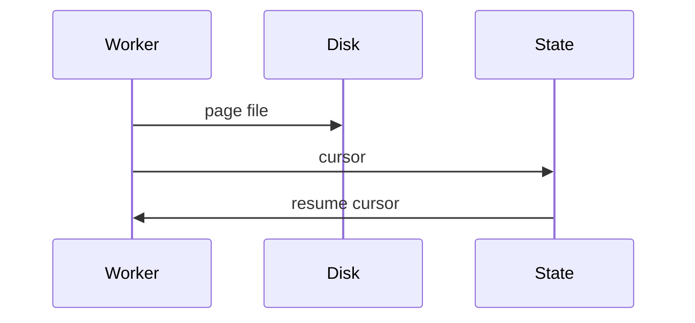

# Idempotency, checkpoints, replay

A write is idempotent when doing it twice leaves the same rows. Checkpoints say where to resume. Replay is how you fix a bug without asking the source to remember you.

Analogy: A rubber stamp that says 'this invoice number already exists' instead of printing a second invoice.

## Keys

Dedup on a stable id. If two versions exist, keep the newer updated_at or the higher log position. A random UUID per retry is not a key. It manufactures duplicates.

Watermarks are for incremental pulls. Checkpoints are for the cursor, offset, file, or log position inside a run. Reconciliation compares the source count to the landed unique keys.

## Backfills

A backfill is a deliberate replay of a range. Isolate it so it does not move the live watermark backward. Write to the same keys so the live stream and the backfill converge.

## Diagram: Write, then checkpoint

1. **Durable page.** The data hits disk first.
2. **Checkpoint.** Now a kill can resume. The reverse order can skip a page.
3. **Replay.** The next process starts at the cursor, not at zero.

## Landing

State store holds the cursor. The lake holds the rows. They advance together, data first.
