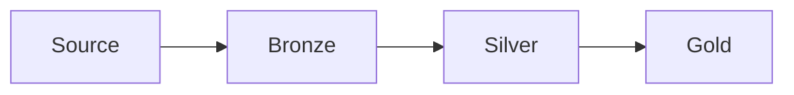

# Landing architecture

Bronze is what you received, plus metadata. Silver is cleaned and deduped. Gold is what the business queries. The destination might be a lakehouse, a warehouse, or a search index. The layers still apply.

Analogy: The loading dock, the sorting room, and the shop floor. You do not let customers walk the dock, and you do not throw away the packing slip.

## Layers

Bronze keeps the raw payload, the source URL or offset, the ingest time, and the run id. You can rebuild silver from it.

Silver dedups, types fields, applies tombstones, and passes contracts. Gold is joined, aggregated, and named for a decision.

A lakehouse keeps files and transactions. A warehouse is SQL-first. A search or vector store is a serving copy, not the system of record, unless you designed it to be.

## Diagram: Bronze, silver, gold

1. **As received.** Raw plus metadata. No business rules yet.
2. **Clean.** Dedup, types, deletes, contract.
3. **Serve.** Gold is rebuildable from silver. Consumers do not read bronze.

## Landing

This page is the landing pattern. Every family module ends by saying what bronze must keep so silver can be rebuilt.
