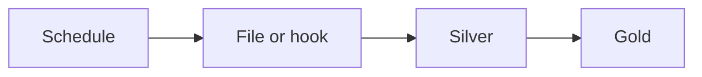

# Orchestration

Something has to start the job, wait for its dependencies, retry the run, and backfill a day. Cron, Airflow, Data Factory, and job schedulers are that something. A webhook can start a run too.

Analogy: A dispatcher. The trucks still do the driving. The dispatcher decides when, and what happens if a truck does not return.

## Scheduled versus triggered

A schedule is right for a nightly file or a daily incremental. An event trigger is right when a webhook or a file arrival should start the load. Dependencies matter: do not build gold until silver for that run succeeded.

Backfills are orchestrated replays of a date range, with the live schedule left alone or paused for that dataset. A failed run should be visible, not a cron line that nobody reads.

## Diagram: Trigger or schedule, then depend

1. **Start.** A clock or an arrival starts the extract. Not both, unless you dedup the run.
2. **Silver first.** Gold waits. A partial silver is not a signal to publish.

## Examples

- Orchestrators: Cron, Airflow, platform jobs. Pattern: cron for a single machine, a workflow tool when you have dependencies and backfills. Product names change. No schedule SLA is claimed. Source: https://airflow.apache.org/docs/

## Landing

The orchestrator stores run state. The lake stores data. Do not use a green task as the only copy of the watermark.
