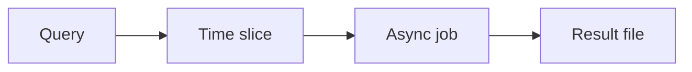

# Query APIs

You send a query, a search, or SQL-over-HTTP. The provider caps rows, bytes, and time. Big questions have to be sliced, or turned into an async job.

Analogy: Asking a researcher one enormous question and being told the answer will not fit on a page, and they will hang up after a minute.

## Why the cap exists

A log or warehouse query can scan terabytes. The API is a front door, not the engine. Row caps, byte caps, and timeouts keep one question from owning the cluster.

Search APIs add relevance windows and deep-paging bans. Offset 100000 in search is often rejected on purpose.

## Workaround

Time-slice: one query per hour, or per partition key. Or submit an async query job, poll, and download the file. Do not loop offset until the server refuses.

Save the query text and the slice bounds with the output. A rerun must be the same question or you cannot explain a different count.

## Diagram: Slice a query that will not fit

1. **Too big.** The synchronous call hits a row cap or a timeout.
2. **Slice.** Same query, narrower time or key range.
3. **Or export.** If the API offers a job, poll and download instead of paging.
4. **Land.** Each slice is a file with its bounds in the name.

## Examples

- Pattern: SQL-over-HTTP and search. Pattern: row caps, byte caps, and timeouts are normal. Read the specific engine's docs before you cite a number. None is invented here. Source: https://www.elastic.co/guide/en/elasticsearch/reference/current/paginate-search-results.html

## Landing

One object per slice, plus a manifest of slices. Completeness is 'every slice succeeded', not 'the last call returned fewer than the cap' if a middle slice failed.
