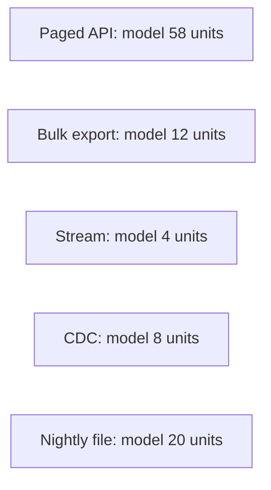

# The race

The same dataset can arrive by paging, by a bulk file, by a stream, by CDC, or by a nightly drop. They finish at different times and they mean different things by fresh.

Analogy: Five ways to get the same books. One is a person walking the shelves. One is a truck. One is a conveyor that never stops.

## Read the lanes

The times in the diagram are illustrative, labeled as a model, not a benchmark. Paging pays latency per page. Export pays a job plus a download. A stream is already moving, so 'finish' means caught up, and freshness is seconds if you keep up. CDC is similar, after the snapshot. A file drop is as fresh as the partner's schedule, often a day, and then it finishes in one load.

## Diagram: Illustrative finish and freshness

1. **Start.** All five start when you notice you need the data. The stream and the file may have been moving already.
2. **Early finishers.** A stream that is already populated looks fastest because you did not backfill. A backfill is a different race.
3. **Paging still walking.** The paged API is still in the rate-limit math. Threads will not change that term.
4. **What fresh means.** Export and files are snapshots. Streams and CDC are changes. Do not compare their clocks as if they were the same question.
5. **Pick.** If you need history once, export or CDC snapshot. If you need tomorrow morning, a file may be enough. If you need minutes, a stream, CDC, or delta plus webhook.

## Landing

Land each lane in bronze with a 'as of' or an offset. Do not mix a snapshot and a stream into gold without a merge rule.
