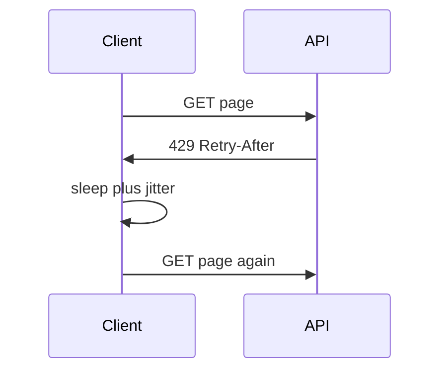
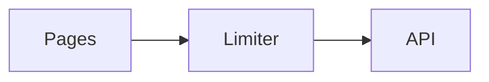

# Rate limits and quotas

A limit is a budget, and the window matters more than the number. Concurrency helps until pages / allowed_rate is the larger term. After that, threads only buy 429s.

Analogy: A turnstile that lets 5 people through every 30 seconds. Bringing 40 friends does not make the museum faster. It makes a crowd at the door.

## Why providers throttle

The API is a shared machine. One noisy client can take the CPU, the database, and the egress. Limits are per user, per app, per tenant, per IP, or per token, and some endpoints have a second, stricter bucket.

Cost-based limits charge points per query instead of one point per call. A wide GraphQL query can spend the budget of a hundred cheap calls. Daily quotas are a different clock from per-second limits.

## What to do

Read Retry-After and the rate-limit headers. Do not invent the window if the header is only a number. A client-side token bucket keeps you under a budget you already know. Retry 429 and 5xx with exponential backoff and jitter. Do not retry 400.

Minimum pull time is pages divided by the allowed rate. If that number is an hour, the fix is a larger page, a bulk export, an incremental filter, or a higher quota. Not more threads.

Multiple credentials can raise throughput only if the terms allow it. Splitting one customer's pull across borrowed keys to dodge a limit is often a terms violation, not an architecture.

## Diagram: A 429 is information

1. **Under budget.** The call is cheap until the window is full.
2. **Over budget.** The header is the earliest legal retry. Ignoring it creates a retry storm.
3. **Back off.** Jitter stops a fleet of clients from waking up together.
4. **Resume.** The page was not lost. It was delayed.

## Diagram: Where time goes

1. **Count pages.** pages = ceil(records / page_size).
2. **Two clocks.** Time is the max of pages × latency / concurrency and pages / rate.
3. **Cap.** If the rate term wins, extra concurrency highlights the limiter, not the API.

## Examples

- Developer tools: GitHub REST. Checked 2026-10-28 on the official rate-limit page: unauthenticated requests are 60 per hour per IP. Authenticated personal access tokens are 5,000 per hour. Secondary limits include no more than 100 concurrent requests. Search and GraphQL have their own budgets. Source: https://docs.github.com/en/rest/using-the-rest-api/rate-limits-for-the-rest-api
- Government: FDIC BankFind. Checked 2026-10-28 with live calls: every response included X-Ratelimit-Limit: 20. The header did not name the window. Eight quick calls succeeded, so it is not a one-per-second cap, and the window is still unpublished. Do not invent it. Source: https://api.fdic.gov/banks/docs/
- Government: NVD CVE API. The developers pages are a client-rendered app. On 2026-10-28 the static HTML did not include the numeric rate limit, so this course does not quote one. A live call the same day returned startIndex, resultsPerPage, and totalResults. Read the developers page the day you build the pull. Source: https://nvd.nist.gov/developers/start-here

## Landing

Land pages as they succeed. A checkpoint plus a client limiter means a multi-hour pull can stop and resume without duplicating finished pages.
