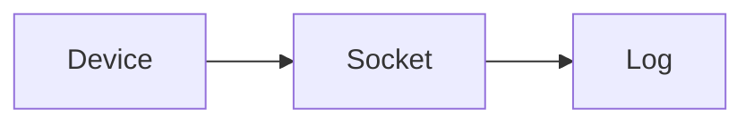

# WebSockets, SSE, long polling, MQTT

Some sources keep a connection open. WebSockets and MQTT are bidirectional. Server-Sent Events are a one-way stream. Long polling is a loop of requests that wait. None of them is a database.

Analogy: Holding the phone instead of sending letters. If the call drops, you need a sentence number to know what you missed.

## Why a live connection

IoT devices and trading screens cannot wait for a nightly file. A socket is low latency. It is also fragile: proxies time out, laptops sleep, and brokers restart.

Heartbeats tell you the connection is alive. A resume token or a last message id tells you what to replay. Without that, a reconnect is a hole.

## Landing

Write events as they arrive, with the resume token. On disconnect, buffer is gone unless you persisted it. Backfill from a REST or file API for the gap, then resume the socket.

MQTT topics and QoS levels change the duplicate story. QoS 1 can duplicate. Design the sink as idempotent anyway.

## Diagram: Disconnect and resume

1. **Live.** Events flow. Persist the resume token with each batch.
2. **Drop.** The socket dies. Events during the gap are not in your process memory.
3. **Resume.** Reconnect with the token, and backfill from the API if the token cannot cover the gap.

## Examples

- IoT: MQTT. Pattern: pub/sub for devices, with QoS and sessions. Confirm the broker's session expiry. No device-rate number is claimed. Source: https://mqtt.org/
- Web: SSE and WebSockets. Pattern: SSE is server to client over HTTP. WebSockets are bidirectional. Both need heartbeats and a resume story. Long polling is the fallback when a socket is blocked. Source: https://html.spec.whatwg.org/multipage/server-sent-events.html

## Landing

Append-only event files with the resume token in the manifest. Do not treat an open socket as proof of completeness.
