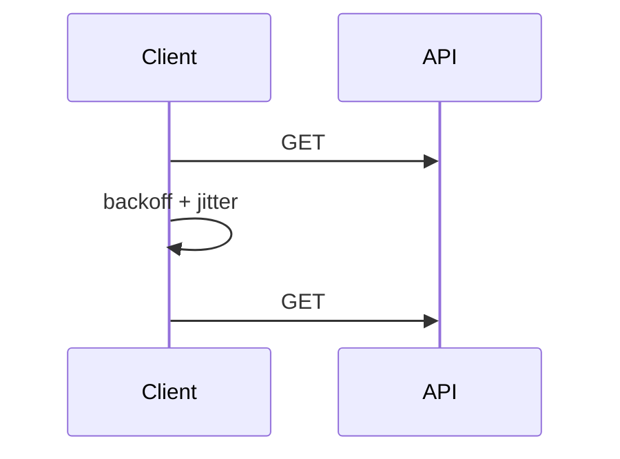

# Timeouts, retries, circuit breakers

Timeouts bound a wait. Retries cover a blip. A circuit breaker stops you from retrying a source that is down. A bulkhead stops one source from eating every thread.

Analogy: Knocking again if nobody heard you. If the building is on fire, stop knocking and try later. Do not send the whole company to knock.

## Rules

Every call has a timeout. Retry 429, 500, 502, 503, 504, timeouts, and connection resets. Honor Retry-After. Otherwise exponential backoff with jitter. Do not retry 400 or 401.

A circuit opens after repeated failures and fails fast. Half-open lets one trial through. Closed is healthy. Dead-letter the events you cannot apply, with the error, so a human can replay them.

## Diagram: Circuit breaker

```mermaid
stateDiagram-v2
  closed --> open
  open --> half-open
```

1. **Closed.** Calls go through. Failures are counted.
2. **Open.** Too many failures. Calls fail fast. The source gets a rest.
3. **Half-open.** One trial. Success closes. Failure opens again.

## Diagram: Retry only what can succeed later



1. **Call.** Timeout or 503.
2. **Wait.** Do not stampede.
3. **Retry.** A 400 would have stopped here. The request was wrong, not unlucky.

## Landing

Dead letters are a landing zone too. They are how you avoid losing a poison event inside a retry loop.
