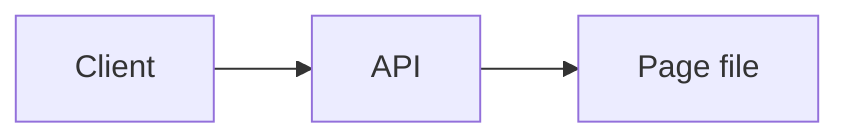
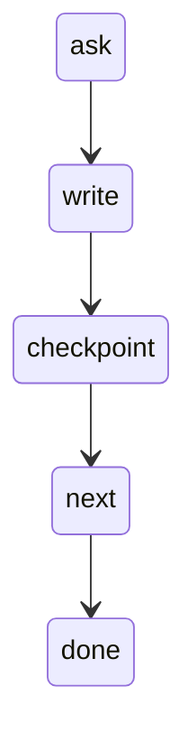
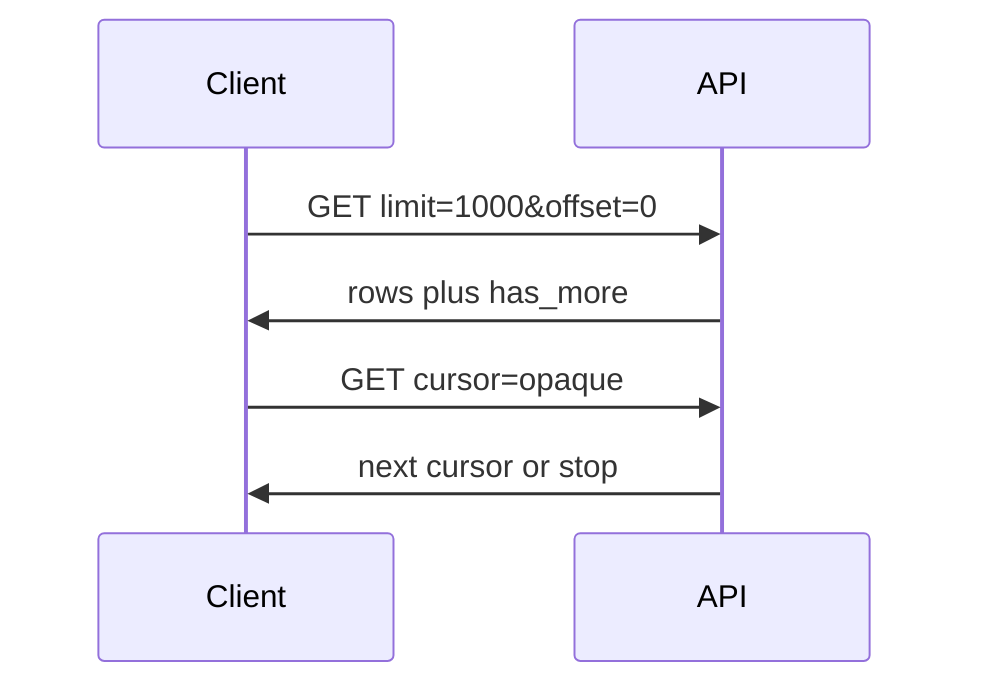

# REST pagination

A page cap is the provider protecting memory, timeouts, and other callers. Offset, page numbers, cursors, keyset, Link headers, and OData nextLink are different ways to say 'come back'.

Analogy: A librarian will not hand you the whole building. Offset is 'skip 400 shelves'. A cursor is a bookmark they wrote. Keyset is 'the book after this call number'.

## Why it exists

One response that holds every row can exhaust the server while it builds JSON, die at a gateway timeout, and starve every other client. The cap is a product decision, not a hint that the table has 1,000 rows.

From the provider's side, a page is also a fairness unit. They can rate-limit requests. They cannot fairly rate-limit one client who asked for the universe.

## The styles

Offset and page numbers are easy and parallelizable, and wrong if rows move. Deep offset gets slower because the database often walks the skipped rows and throws them away.

A cursor or an OData @odata.nextLink is an opaque URL or token. You do not parse it, and you cannot invent the next one, so you cannot fan that walk out across threads.

Keyset is WHERE id > last_id. The index seeks, depth stays cheap, and you can cut the key space into ranges. A Link header is the same idea hiding in RFC 5988. Clients that only read JSON stop after page one.

## How not to lose rows

Stop on an empty page or has_more=false, not on a total counted at the start. Advance by the number of rows you actually received. Write each page before you checkpoint. Dedup on the primary key and keep the newest updated_at.

If the table is live, do not trust offset. Ask for a cursor, a keyset, or a snapshot export.

## Diagram: Page, land, next page

1. **Ask.** One request. One page. Not the table.
2. **Return.** The server caps the body and returns a next hint.
3. **Land.** Write the page before the next request. A crash keeps finished pages.
4. **Continue.** Follow the hint. Do not hold the whole dataset in a list.

## Diagram: Pagination loop

1. **Ask.** Send limit plus offset, cursor, or after_id.
2. **Write.** Stream the page to disk. Memory stays flat.
3. **Checkpoint.** Save the cursor after the write, so a kill can resume.
4. **Next.** If the hint says more, loop. If not, stop.
5. **Done.** Validate unique keys against the reported total.

## Diagram: Offset versus a cursor

1. **First offset page.** Easy to start. The next offset is arithmetic.
2. **Page back.** If a row is inserted above you, the next skip repeats one row and drops another.
3. **Cursor page.** The token was minted by the previous response. You cannot start at page 40.
4. **Consistent walk.** Consistent, and sequential on purpose.

## Examples

- Government: FDIC BankFind. Checked 2026-10-28: limit and offset, default 10, maximum 10,000, total in meta.total. A live pull of 27,835 institutions at page size 10,000 was 3 requests and 2.9 seconds. limit=10001 returned HTTP 400. Source: https://api.fdic.gov/banks/docs/swagger.yaml
- Identity: Microsoft Graph. Checked 2026-10-28: collections page. GET /users returns a default of 100. Further pages are an @odata.nextLink URL you call as-is. Source: https://learn.microsoft.com/en-us/graph/paging
- Payments: Stripe lists. Checked 2026-10-28: list methods take limit (default 10, range 1 to 100), starting_after, and ending_before. has_more says whether another page exists. Source: https://docs.stripe.com/api/pagination
- Developer tools: GitHub REST pagination. Checked 2026-10-28: GitHub paginates with a Link header (rel=next, prev, first, last). The issues example on that page returns 30 results even when more exist. per_page changes the page size. This course does not quote a maximum it did not copy from the page. Source: https://docs.github.com/en/rest/using-the-rest-api/using-pagination-in-the-rest-api

## Landing

Raw pages as NDJSON or the original JSON, plus the request URL and cursor in the file name. Silver is deduped on the primary key. Gold is the business table. Do not compact before the page is durable.
