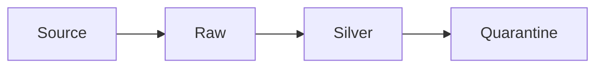

# Schema drift and contracts

Sources add fields, rename fields, and change types. A pipeline that assumes yesterday's shape will either crash or silently shift meaning. A contract says which change is allowed.

Analogy: A form that grows a new box. If you read by column number, the amount becomes the phone number.

## What to do

Land the raw payload so a new field is not lost even if silver does not know it yet. Evolve silver explicitly. Additive fields are usually safe. Type changes and renames are breaking.

A data contract is the agreement: required fields, types, and who may change them. Test it on every batch. Quarantine violations.

## Diagram: Schema change

1. **New field.** Raw still stores it. Silver ignores unknown fields until you opt in.
2. **Breaking change.** A type change fails the contract. Quarantine the batch. Do not coerce quietly.
3. **Evolve.** Update the contract, backfill if needed, resume.

## Landing

Bronze is schemaless or self-describing. Silver is contracted. Gold is stable names the business uses.
