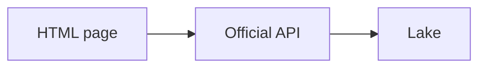

# Scraping, last

Scraping reads HTML because there is no API. It breaks when the page changes, and it can be illegal or forbidden even when it is technically easy. Prefer an official feed. Use demo sites if you practice.

Analogy: Copying a shop window because they would not give you a catalog. The window changes, and the shop may have a rule against it.

## Rules, before code

Read the terms of service, robots.txt, and copyright. Personal data on a page is still personal data. Rate courtesy is not a legal defense, but hammering a site is how you get blocked and how you cause harm.

If an API, a file, or a data portal exists, use it. Scraping is the last resort for public pages you are allowed to read, not a clever way around a login.

## If you still must

Static HTML can be parsed. JavaScript-rendered pages need a browser, which is slower and more fragile. Anti-bot systems will beat a casual script. Do not teach bypasses here, and do not build them.

Store the raw HTML and the URL and the time. Expect the selectors to break. Alert on a sudden drop to zero rows.

## Diagram: Prefer the official door

1. **Fragile.** A selector extract dies when a div is renamed. You also may not be allowed to do it.
2. **Official.** An API or file feed is the supported contract.

## Examples

- Practice only: Sites built for scraping practice. Use sites that invite practice, such as books.toscrape.com, and stay inside their terms. This course does not include bypass techniques. Source: https://books.toscrape.com/

## Landing

If a scrape is allowed, bronze is raw HTML. Silver is parsed fields with the selector version. A zero-row run is an incident, not an empty day.
