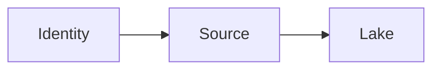

# Security and compliance

Least privilege, no secrets in git, a plan for personal data, an audit trail of who pulled what, and a residency rule for where bytes may sit.

Analogy: A key that opens one cupboard, not the building, and a log of who used it.

## Minimum

Read-only credentials. Separate credentials per environment. Rotate them. Do not log payloads that contain personal data unless the log store is approved for that data.

Residency is a placement rule: some datasets cannot leave a region or a tenant boundary. A convenient SaaS extractor can violate it. Ask before you connect.

Audit the run: who, what source, what time range, how many rows. That is how you answer an incident.

## Diagram: Least privilege

1. **Read only.** The credential can list and read the one collection. It cannot write or see the rest of the tenant.
2. **Land in bounds.** The lake is in the allowed region. The audit row records the pull.

## Landing

Bronze may contain personal data. Access to bronze is narrower than access to gold. Mask or drop fields in silver if gold does not need them.
