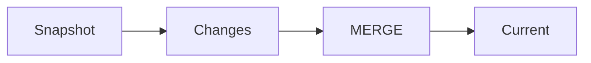

# Snapshot, incremental, history

A snapshot is the world at one time. An incremental feed is what changed. An event history is every fact. Merging them is a full refresh, an upsert, or a slowly changing dimension, plus a plan for deletes.

Analogy: A photograph, a list of edits, and a diary. You cannot reconstruct the diary from the photograph.

## Choose the grain

Full refresh replaces the table. It is correct for small dimensions and painful for billions of rows. Upsert or MERGE applies changes and needs tombstones for deletes.

Slowly changing dimensions keep history on purpose. That is a modeling choice, not something CDC gives you for free. Store the effective time.

## Diagram: Merge a change onto a snapshot

1. **Base.** The snapshot is the starting picture.
2. **Apply.** Updates replace. Tombstones delete. Inserts add.
3. **Current.** The serving table is the merge, not the raw feed.

## Landing

Keep snapshot and changes in bronze. Silver is the merge. Do not throw away bronze after the first success. You will rerun it.
