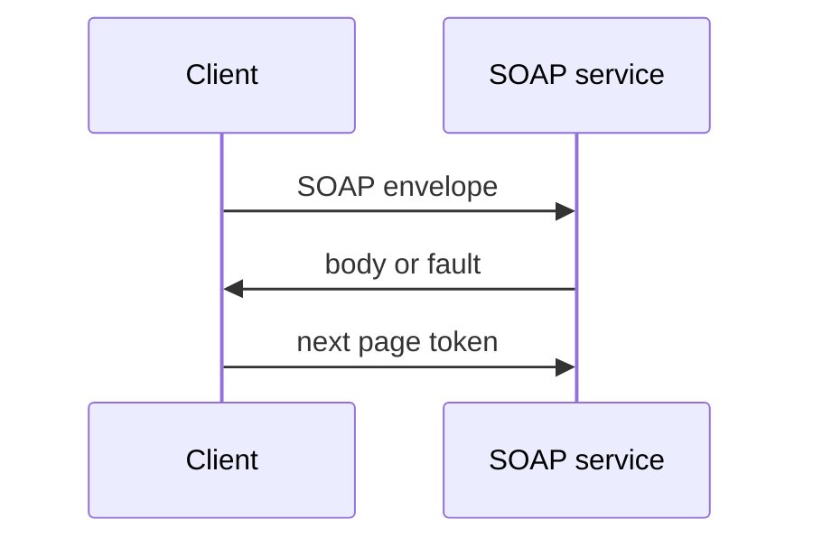

# SOAP and legacy APIs

SOAP is still how many banks, governments, and ERPs expose data. You get a WSDL contract, an XML envelope, and paging conventions that predate JSON. The extraction rules do not change.

Analogy: A form with a cover sheet. The cover sheet is the envelope. The form is the body. Losing the cover sheet means the other side will not read the form.

## Why it is still here

Enterprises bought these systems when XML contracts and WS-Security were the interoperability story. Replacing them is a multi-year program. Your pipeline does not get to wait.

Paging may be a page number inside the body, a continuation token, or a maximum rows element. Read the WSDL and a captured response. Do not assume limit and offset.

## How to extract it

Send the envelope, parse the body, write the page, repeat. Watch SOAP faults separately from HTTP status. A HTTP 200 can still carry a fault. Namespaces will break a naive string search.

Prefer the vendor's bulk or file interface if one exists. SOAP paging a million rows is the same hour-long problem as REST, with more XML.

## Diagram: Envelope in, page out

1. **Request.** Action, auth header, and page token live in XML, not always in the URL.
2. **Response.** HTTP 200 plus a Fault is still a failure. Do not land it as data.
3. **Continue.** The token is in the body. Checkpoint that, not the HTTP status.

## Examples

- Enterprise: ERP and bank cores. Pattern, not a measured limit: many core systems still publish WSDL. Confirm page size in that WSDL. This course does not invent a vendor maximum. Source: https://www.w3.org/TR/soap12-part1/

## Landing

Store the raw XML page and a parsed NDJSON projection. Keep the raw envelope until silver validation passes. Schema changes show up as new elements, not as a friendly JSON field.
