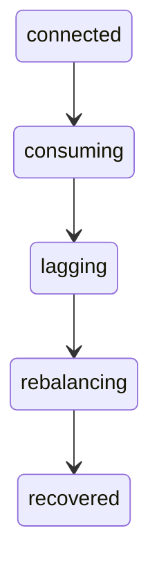
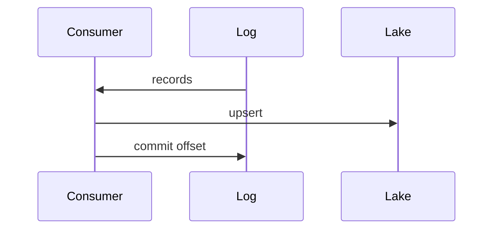
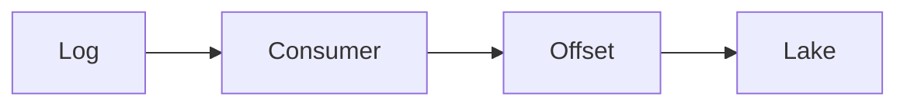

# Streaming platforms

Kafka, Event Hubs, Kinesis, and Pub/Sub are logs. Producers append. Consumers read at their own pace, in a group, from a checkpoint. Retention is how long you can replay. Lag is how far behind you are.

Analogy: A conveyor belt with several lanes. If you blink, the belt does not rewind unless you kept a note of the last box you put on the shelf.

## Why a log

Many consumers need the same events, and they need to replay after a bug. A queue that deletes on read cannot do that. A log keeps events for the retention window and lets each group keep its own offset.

Ordering is per partition, not global. Choose the partition key to be the entity that must stay in order, usually the account or device id, not a random value.

## How not to lose or double

At-least-once is the normal contract. Commit the offset after the sink write. Commit before the write and a crash loses events. A crash after the write and before the commit replays them. Idempotent sinks make the replay safe.

Lag, retention, and dead-letter queues are the operating picture. If lag exceeds retention, those events are gone. That is data loss. Alert before that.

Schema registries exist so a new field does not break every consumer. Capture connectors can land the log in the lake. That is a copy, still not a business model.

## Diagram: Consumer

1. **Connected.** The group assigned partitions. You have not read yet.
2. **Consuming.** Read, write, then commit the offset.
3. **Lagging.** The producer is faster than you. Lag is visible. Retention is the cliff.
4. **Rebalancing.** A member died or joined. Partitions move. Pause writes until you know your assignment.
5. **Recovered.** Resume from the committed offset, not from the start, and not from the tip, unless you chose that.

## Diagram: Commit after the write

1. **Read.** The log still has them. Reading is not consuming them away.
2. **Sink.** Idempotent write on the event key.
3. **Checkpoint.** Only now may a crash skip ahead. Before this, a crash replays.

## Diagram: Crash before checkpoint

1. **Wrote, did not commit.** The row is in the lake. The offset is old. A restart will write the row again.
2. **Idempotent sink.** The second write matches the same key and updated_at. The table does not double.
3. **Then commit.** Offset moves. Replay window closes.

## Examples

- Platform: Kafka and relatives. Pattern: topics, partitions, consumer groups, offsets, retention, replay. Kafka, Event Hubs, Kinesis, and Pub/Sub rhyme. Their exact retention defaults and throughput units differ. Read the current service page before you cite a number. None is invented here. Source: https://kafka.apache.org/documentation/
- Security and markets: Vendor streams into a bus. Pattern: a product streams events to Event Hubs, Pub/Sub, or storage. You consume the bus. You do not page the product's REST API for every event. Confirm the vendor's retention and schema in their docs. Source: https://learn.microsoft.com/en-us/azure/event-hubs/event-hubs-about

## Landing

Bronze can be the captured log. Silver is deduped events. Gold is aggregates. Keep the consumer group offset outside the gold table so a rebuild can replay.
