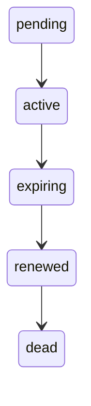
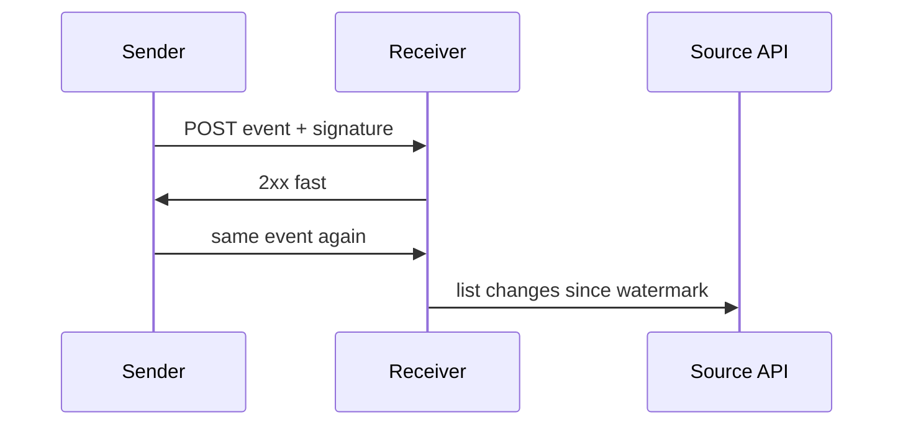
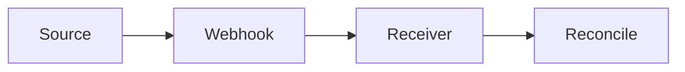

# Webhooks

A webhook is a doorbell. The sender retries, signatures prove who rang, and some rings never arrive. A webhook feed without a reconciliation pull will lose data.

Analogy: A doorbell that sometimes does not ring, sometimes rings twice, and can be mimicked by a stranger unless you check the signature.

## Why providers push

They already know the row changed. Pushing is fresher than you polling every minute, and cheaper for them if you are idle. It is a hint, not a ledger.

Subscriptions expire. Handshake validation proves you own the URL. Ordering is not guaranteed. Duplicates are normal because the sender retries when your endpoint times out.

## The reliable shape

Verify HMAC or the vendor signature before you parse. Dedup on the event id. Ack fast, process later from a queue. Renew subscriptions before they expire.

Run a reconciliation job that pulls the source of truth and fills gaps. Missed events are expected. A system that only listens will silently drift.

## Diagram: Subscription

1. **Pending.** Handshake: the provider calls you and expects a specific response.
2. **Active.** Events arrive. Verify, dedup, enqueue.
3. **Expiring.** The subscription has a clock. Notice it before it dies.
4. **Renewed.** Renew, or the doorbell is disconnected and you will not hear a failure.
5. **Dead.** Expired or revoked. Reconciliation is the only remaining path.

## Diagram: Validate, then maybe miss one

1. **Delivery.** Reject a bad signature before you touch the database.
2. **Ack.** Slow work belongs on a queue. A timeout makes the sender retry.
3. **Duplicate.** The event id is the dedup key.
4. **Reconcile.** The pull finds the ring that never arrived.

## Diagram: Missed webhook

1. **Dropped.** The sender tried. Your side never stored the event. The row still exists at the source.
2. **Notice.** A completeness check compares source ids to received ids.
3. **Fill.** The reconciliation pull lands the missing row. The webhook was a hint.

## Examples

- Collaboration: Signed webhooks. Pattern: HMAC over the raw body, plus a timestamp to limit replay. Confirm the exact header and base string in the vendor docs. No sample secret belongs in this repo. Source: https://docs.github.com/en/webhooks/using-webhooks/validating-webhook-deliveries
- E-commerce: Order webhooks. Pattern, not a store's SLA: treat each event as at-least-once, dedup on the event id, and reconcile against the orders API. Illustrative drop rates belong in the simulator, not in a contract. Source: https://en.wikipedia.org/wiki/Webhook

## Landing

Bronze is the raw body, signature result, and event id. Silver is the business object after dedup. Reconciliation writes the same silver key so a late webhook and a pull converge.
